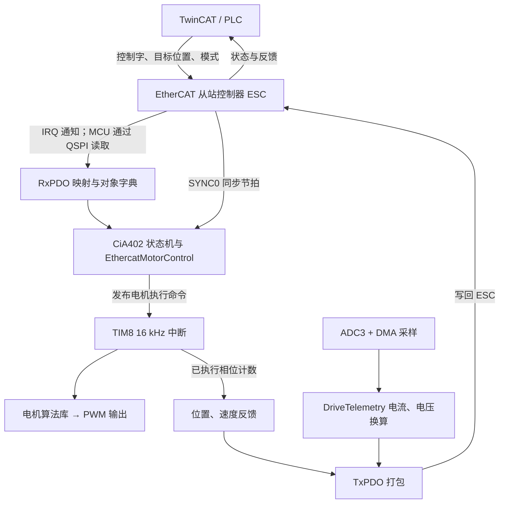

我核对了 Keil 工程文件和现有链接清单。**当前软件是 N32G455 裸机程序，采用“后台主循环＋中断”结构，没有 RTOS；工程包含 49 个 C 文件、1 个汇编启动文件，并链接 `N32G455.lib`。**

你周末阅读时，建议先顺着“一个目标位置怎样变成电机运动”理解，不要从协议栈、外设库逐个文件往下看。

## 一、先看整体链路

````

````

这里有三个必须分清的概念：

- **EtherCAT 通信周期**：决定主站多久发送一次目标，例如你此前设置的 2 ms。
- **SYNC0**：给从站提供同步节拍，不是直接输出给电机的 PWM。
- **电机执行周期**：当前由 TIM8 按 **16 kHz** 调用电机处理，即约每 62.5 μs 一次。

所以，不是“收到一帧 PDO，就执行一次完整电机算法”。

## 二、按实际执行顺序理解代码

### 1. 上电：先初始化，再进入后台循环

从 [main.c (line 10)](C:/Users/pc/Desktop/01_FCM4E1553_SQI_82_CTT_V1.4/program/FCM4E1553 Ethercat/User/main.c:10) 开始。

启动顺序大致是：

```
Reset_Handler
→ SystemInit
→ C 运行环境初始化
→ main
→ ESC/QSPI、GPIO、串口、EEPROM、Modbus 初始化
→ 遥测、DMA、ADC 初始化
→ 电机数据初始化
→ EtherCAT 协议栈初始化
→ CiA402 初始化
→ EthercatMotorControl 初始化
→ PDO 映射检查
→ PWM/TIM8 启动
→ 后台循环
```

正常后台循环的核心是：

```
MainLoop();
EthercatMotorControl_Update();
DriveTelemetry_Update();
modbus_process();
eeprom_console_process();
```

这五个调用可以理解为：

| 调用                            | 负责什么                                                     |
| ------------------------------- | ------------------------------------------------------------ |
| `MainLoop()`                    | EtherCAT 状态处理、邮箱/CoE 服务、同步检查、CiA402 状态机等  |
| `EthercatMotorControl_Update()` | 把对象字典里的命令转换成电机执行命令，处理使能、模式、限幅、故障及反馈 |
| `DriveTelemetry_Update()`       | 将 ADC 采样换算为监测量，更新数据有效性                      |
| `modbus_process()`              | RS485 Modbus 通信                                            |
| `eeprom_console_process()`      | EEPROM 调试命令处理                                          |

**注意：IRQ、SYNC0、TIM8、DMA 的中断不需要等后台循环走到某一行才执行。**

### 2. 主站命令如何进入软件

主要看两个文件：

- [el9800hw.c (line 696)](C:/Users/pc/Desktop/01_FCM4E1553_SQI_82_CTT_V1.4/program/FCM4E1553 Ethercat/Ethercat/port/el9800hw.c:696)：硬件中断入口、ESC 访问接口。
- [ecatappl.c (line 650)](C:/Users/pc/Desktop/01_FCM4E1553_SQI_82_CTT_V1.4/program/FCM4E1553 Ethercat/Ethercat/src/ecatappl.c:650)：事件处理和 PDO 收发调度。

接收链路是：

```
ESC 的 IRQ 拉低
→ EXTI0_IRQHandler / EcatIsr
→ PDI_Isr
→ 检查 AL Event
→ PDO_OutputMapping
→ 通过 QSPI 读取 RxPDO
→ APPL_OutputMapping
→ 写入本机对象字典中的控制参数
```

这里的 `Output` 是从**主站视角**命名的：主站输出给驱动器的数据，也就是驱动器的 RxPDO。

重点关注这些对象：

| 地址     | 在控制链路中的作用                 |
| -------- | ---------------------------------- |
| `0x6040` | 控制字，决定使能、停止、复位等请求 |
| `0x6060` | 请求的运行模式                     |
| `0x607A` | 目标位置                           |
| `0x60FF` | 目标速度                           |
| `0x6041` | 驱动器状态字                       |
| `0x6061` | 实际采用的模式                     |

MCU 是通过 QSPI 访问 ESC，不是由 MCU 自己运行普通 TCP/IP 协议来接收这些命令。

### 3. CiA402 状态机决定“能不能动”

主要看 [cia402appl.c (line 1099)](C:/Users/pc/Desktop/01_FCM4E1553_SQI_82_CTT_V1.4/program/FCM4E1553 Ethercat/Ethercat/src/cia402appl.c:1099)：

- `CiA402_StateMachine()`：处理控制字和驱动状态转换。
- `CiA402_Application()`：处理相关停止、故障等应用动作。
- `APPL_OutputMapping()`：解析收到的 PDO。
- `APPL_InputMapping()`：打包反馈 PDO。
- `APPL_Application()`：应用周期处理，并在 DC 模式下通知电机控制层获取同步命令。

**EtherCAT 的 OP 状态，不等于电机已经使能。**

通信进入 OP 后，CiA402 还必须进入 `Operation Enabled`，并且软件没有相关故障，电机控制层才允许输出。

### 4. 电机控制层决定“怎么动”

最值得花时间读的是：

[EthercatMotorControl.c (line 905)](C:/Users/pc/Desktop/01_FCM4E1553_SQI_82_CTT_V1.4/program/FCM4E1553 Ethercat/User/EthercatMotorControl.c:905)

建议依次搜索：

| 函数                                                         | 阅读重点                                 |
| ------------------------------------------------------------ | ---------------------------------------- |
| `EthercatMotorControl_OnSyncCycle()`                         | 在同步边界保存目标、模式等命令快照       |
| `EthercatMotorControl_Update()`                              | 主入口：检查状态、模式、故障、目标和反馈 |
| `EthercatMotorControl_SelectCommand()`                       | 根据 PP、CSP、PV、CSV 等模式选择处理路径 |
| `EthercatMotorControl_PublishPulseCommand()`                 | 把准备好的命令交给高速中断侧             |
| `EthercatMotorControl_NextPhaseStep()`                       | 计算本次电机周期应执行的相位步进         |
| `EthercatMotorControl_BeginPhaseCycle()` / `EndPhaseCycle()` | 记录本周期实际执行的相位变化             |
| `EthercatMotorControl_EmergencyStop()`                       | 软件紧急停止处理                         |

位置与相位换算还要结合 [EcatPulsePosition.h](C:/Users/pc/Desktop/01_FCM4E1553_SQI_82_CTT_V1.4/program/FCM4E1553 Ethercat/User/EcatPulsePosition.h) 阅读。

这一层相当于：

> 上面接收 EtherCAT 的“位置/速度命令”，下面输出电机算法能使用的“每个控制周期怎么走”。

### 5. TIM8 中断真正执行电机算法

看 [PwmInit.c (line 152)](C:/Users/pc/Desktop/01_FCM4E1553_SQI_82_CTT_V1.4/program/FCM4E1553 Ethercat/User/PwmInit.c:152) 中的 `TIM8_UP_IRQHandler()`。

大致执行关系：

```
TIM8 更新中断
→ 记录执行前的相位
→ 检查故障和 PDI 状态
→ 正常时调用 MainFunt()
→ 记录执行后的相位
→ 更新执行反馈和耗时诊断
```

`MainFunt()` 会调用 [PulseHandle.c (line 41)](C:/Users/pc/Desktop/01_FCM4E1553_SQI_82_CTT_V1.4/program/FCM4E1553 Ethercat/User/PulseHandle.c:41) 中的 `PulseFunction()`，从电机控制层取得本周期步进量。

最后通过 `UpPwm()` 更新 PWM 比较值；该函数还会检查软件是否允许功率输出。

这里有一个重要限制：**`MainFunt()` 等核心电机算法在预编译的 `N32G455.lib` 里。**

链接结果可以确认其中包含：

```
MainFunt
MotorFunc
PhaseGet
CurrentCal
MotorWork
shuzu_initial
```

但仓库没有与这些实现对应的完整 `MotionPID.c` 源文件。因此：

- 能读懂输入、输出和调用关系。
- 不能仅凭现有源码完整阅读库内部的电流计算与调制算法。
- 若要彻底理解或者修改库内部算法，需要原始库源码。

接口声明在 [MotionPID.h](C:/Users/pc/Desktop/01_FCM4E1553_SQI_82_CTT_V1.4/program/FCM4E1553 Ethercat/User/MotionPID.h)；现有链接器生成的 [调用关系报告](C:/Users/pc/Desktop/01_FCM4E1553_SQI_82_CTT_V1.4/program/FCM4E1553 Ethercat/MDK-ARM/N32G455/N32G455.htm) 可以辅助阅读。

### 6. 电流、电压如何返回 TwinCAT

看这两个文件：

- [AdcInit.c (line 61)](C:/Users/pc/Desktop/01_FCM4E1553_SQI_82_CTT_V1.4/program/FCM4E1553 Ethercat/User/AdcInit.c:61)
- [DriveTelemetry.c (line 122)](C:/Users/pc/Desktop/01_FCM4E1553_SQI_82_CTT_V1.4/program/FCM4E1553 Ethercat/User/DriveTelemetry.c:122)

采样与上报链路：

```
TIM8 触发 ADC3
→ ADC 扫描采样通道
→ DMA 搬运到 adc_value[]
→ DMA 完成中断保存采样信息
→ 后台 DriveTelemetry_Update() 换算
→ 发布监测量快照
→ APPL_InputMapping() 打包 TxPDO
→ 写入 ESC
→ 主站读取
```

要特别区分：

- 原电机算法库使用 ADC 数据进行电机相关计算。
- `DriveTelemetry` 负责监测数据的换算、有效性判断和通信上报。
- **新增电流上报，不等于重新实现了电机电流控制环。**

另外，当前 `0x6064/0x606C` 的位置、速度反馈来自内部执行相位计数，**不是编码器测得的转子位置、速度**。因此不能仅凭它们判断电机是否真实失步。

### 7. CoE Online 读参数走的是另一条路

你此前读 `0x6077`、`0x6078`、`0x60F4` 出现 SDO Abort，应该沿这条链路理解：

```
CoE Online 读写请求
→ ESC 邮箱
→ mailbox / ecatcoe / sdoserv
→ objdef 对象访问
→ 对象对应的读写回调
→ 返回数据或 Abort
```

例如 [ReadDriveTelemetry() (line 219)](C:/Users/pc/Desktop/01_FCM4E1553_SQI_82_CTT_V1.4/program/FCM4E1553 Ethercat/User/DriveTelemetry.c:219) 就负责相关监测对象的 SDO 读取检查。

**SDO 参数访问和周期 PDO 传输，是两条不同的路径。**

## 三、哪些文件参与当前编译

依据是 [Project.uvprojx](C:/Users/pc/Desktop/01_FCM4E1553_SQI_82_CTT_V1.4/program/FCM4E1553 Ethercat/MDK-ARM/Project.uvprojx) 的 `N32G455` 目标，并与现有 [链接输入清单](C:/Users/pc/Desktop/01_FCM4E1553_SQI_82_CTT_V1.4/program/FCM4E1553 Ethercat/MDK-ARM/N32G455/N32G455.lnp) 交叉核对。

### 应用层：22 个 C 文件＋1 个库

下面表格中的文件都参与当前目标构建：

| 位置                                                         | 文件                                                         |
| ------------------------------------------------------------ | ------------------------------------------------------------ |
| [User 目录](C:/Users/pc/Desktop/01_FCM4E1553_SQI_82_CTT_V1.4/program/FCM4E1553 Ethercat/User)：主流程、控制与监测 | `main.c`、`EthercatMotorControl.c`、`DriveTelemetry.c`       |
| 同一 User 目录：电机执行与故障                               | `PwmInit.c`、`PulseHandle.c`、`Errorhadle.c`、`SaveFunc.c`   |
| 同一 User 目录：采样、定时与中断                             | `AdcInit.c`、`timer.c`、`exti.c`、`IoIntInit.c`、`n32g45x_it.c` |
| 同一 User 目录：通信与存储                                   | `qspi.c`、`can.c`、`rs485.c`、`SciInit.c`、`uartc.c`、`eeprom.c`、`eeprom_console.c`、`flash.c`、`u_i2c.c` |
| [Ethercat/port 目录](C:/Users/pc/Desktop/01_FCM4E1553_SQI_82_CTT_V1.4/program/FCM4E1553 Ethercat/Ethercat/port) | `el9800hw.c`                                                 |
| User 目录中的预编译库                                        | `N32G455.lib`                                                |

工程里 `Timer.c/QSPI.c` 与磁盘文件大小写可能不同，Windows 下对应同一文件。

### 其余参与编译的文件

| 工程分组        | 数量   | 文件                                                         |
| --------------- | ------ | ------------------------------------------------------------ |
| CMSIS           | 1 C    | `system_n32g45x.c`                                           |
| MDK-ARM         | 1 汇编 | `startup_n32g45x.s`                                          |
| RS485_ModbusRTU | 1 C    | `modbus.c`                                                   |
| Src             | 3 C    | `coeappl.c`、`ecatappl.c`、`cia402appl.c`                    |
| Stack           | 5 C    | `ecatcoe.c`、`ecatslv.c`、`mailbox.c`、`objdef.c`、`sdoserv.c` |
| SYSTEM          | 2 C    | `sys.c`、`systick.c`                                         |
| N32 标准外设库  | 15 C   | `misc.c`、`n32g45x_adc.c`、`n32g45x_can.c`、`n32g45x_dac.c`、`n32g45x_dma.c`、`n32g45x_exti.c`、`n32g45x_flash.c`、`n32g45x_gpio.c`、`n32g45x_i2c.c`、`n32g45x_pwr.c`、`n32g45x_rcc.c`、`n32g45x_spi.c`、`n32g45x_tim.c`、`n32g45x_usart.c`、`n32g45x_qspi.c` |

**参与编译不代表其中每个函数都在运行。** 未被使用的函数可能被链接器裁剪；编译器运行库也会按需参与链接。

### 头文件也很重要

头文件不单独生成一个编译单元，但会被 C 文件包含。尤其不要漏掉：

| 头文件                                                       | 作用                                               |
| ------------------------------------------------------------ | -------------------------------------------------- |
| [cia402appl.h](C:/Users/pc/Desktop/01_FCM4E1553_SQI_82_CTT_V1.4/program/FCM4E1553 Ethercat/Ethercat/Inc/cia402appl.h) | 对象数据结构、CiA402 参数、默认 PDO 和对象字典定义 |
| [DriveTelemetryObjects.h](C:/Users/pc/Desktop/01_FCM4E1553_SQI_82_CTT_V1.4/program/FCM4E1553 Ethercat/User/DriveTelemetryObjects.h) | 新增监测对象的地址、类型、权限、映射和回调         |
| [DriveTelemetry.h](C:/Users/pc/Desktop/01_FCM4E1553_SQI_82_CTT_V1.4/program/FCM4E1553 Ethercat/User/DriveTelemetry.h) | 采样换算参数、监测数据结构、有效性标志             |
| [ecat_def.h](C:/Users/pc/Desktop/01_FCM4E1553_SQI_82_CTT_V1.4/program/FCM4E1553 Ethercat/Ethercat/Inc/ecat_def.h) | 协议栈编译配置，例如 DC、中断等功能开关            |

## 四、哪些不要误认为是当前固件主链路

以下虽然存在，但不属于当前 Keil 目标的编译输入：

- [qep.c](C:/Users/pc/Desktop/01_FCM4E1553_SQI_82_CTT_V1.4/program/FCM4E1553 Ethercat/User/qep.c)：没有加入当前目标，不能因存在此文件就认为已使用编码器反馈。
- [el9800appl.c](C:/Users/pc/Desktop/01_FCM4E1553_SQI_82_CTT_V1.4/program/FCM4E1553 Ethercat/Ethercat/src/el9800appl.c)：通用示例，不是当前 CiA402 应用入口。
- USMART 相关源码、另一套 `SYSTEM/usart/usart.c`、未选用的外设驱动。
- `examples` 中的 TwinCAT PLC 示例：由 TwinCAT 单独编译运行，不进入 MCU 固件。
- `tests` 中的测试代码：用于验证，不是产品固件的运行入口。
- [ESI XML](C:/Users/pc/Desktop/01_FCM4E1553_SQI_82_CTT_V1.4/FCM4E1553_CiA402_SingleAxis_Rev03.xml)：描述设备、对象和 PDO，供主站识别配置，**修改 XML 本身不会实现 MCU 里的功能**。

## 五、周末建议这样读

| 时间     | 阅读内容                                                     | 看完应该能回答的问题                                         |
| -------- | ------------------------------------------------------------ | ------------------------------------------------------------ |
| 周六上午 | `main`、初始化、后台循环                                     | 谁先初始化？哪些函数在循环里，哪些由中断调用？               |
| 周六下午 | `ecatappl`、`cia402appl`、对象字典                           | 主站写入 `607A` 后，数据保存到哪里？为什么 OP 了仍可能不能动？ |
| 周日上午 | `EthercatMotorControl`、`EcatPulsePosition`、`PwmInit`、`PulseHandle` | 目标位置怎样变成每次 TIM8 中断的相位增量？                   |
| 周日下午 | `AdcInit`、`DriveTelemetry`、SDO 回调                        | 电流如何从 ADC 原始值变成通信数据？什么条件下会报无效或 Abort？ |

最有效的读法是追踪三个对象：

1. **`6040`：从主站控制字一直追到“是否允许 PWM 输出”。**
2. **`607A`：从目标位置一直追到“本周期相位增量”。**
3. **`6078`：从 ADC 原始采样一直追到“主站读到的实际电流”。**

把这三条链路走通，当前工程的主体就基本理解了。外设库和完整 EtherCAT 协议栈可以留到遇到具体问题时再深入。这次仅梳理了工程，没有修改代码。